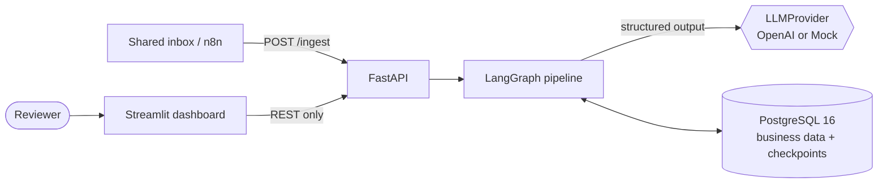
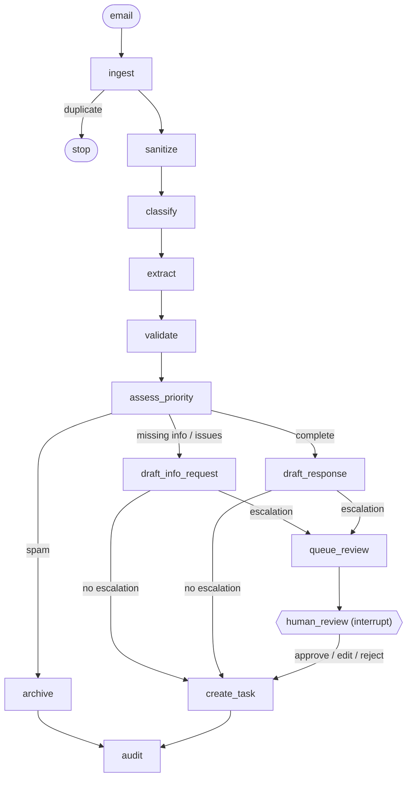

# OpsPilot: AI Operations Assistant

**An agentic system that turns a messy shared operations inbox into classified, validated, routed work, drafts the reply, and makes a human approve anything risky. It runs end to end with no API key.**

<details><summary>Screenshot / GIF: how to capture it</summary>

1. `make demo` and open http://localhost:8501.
2. Record with any screen recorder (macOS: `Shift+Cmd+5`) at 1280x800: Overview, then **Human Review** (open the first case, click **Approve**), then **Simulate** (run a sample, watch the nodes complete).
3. Save as `docs/images/demo.gif` and screenshots as `docs/images/overview.png`, `review.png`; then embed with `` here.
</details>

## The business problem

**Northwind Supply GmbH**: a 200-person B2B distributor of industrial parts in Hamburg. A 4-person operations team triages a shared inbox of ~150 messages a day **by hand**:

| Today | |
|---|---|
| Average first response | ~9 hours |
| Requests bounced back for missing information | 18% |
| Urgent issues | buried in the queue |

## The outcome (projected, assumptions stated)

Measured on the 80-email synthetic inbox (`make demo`, mock provider) and scaled to Northwind's volume:

| | Result | How it is derived |
|---|---|---|
| Handled with no human decision | **44%** (35 of 80) | draft ready to send, or spam archived |
| Missing info caught at triage | **17.5%** (14 of 80) | the specific missing fields are asked for in the *first* reply, so the 18% bounce-back round trip disappears |
| Escalated to a human | **39%** (31 of 80) | this set is deliberately escalation-heavy; production would be lower |
| Triage time per message | **seconds** vs ~6 min by hand | pipeline latency |
| Hours saved per week | **~50 h** (about 1.3 of 4 FTE) | 750 msgs/week x 4.1 min saved |
| First response time | **<= 4 h** vs ~9 h | worst case: every message answered at the *end* of its SLA window (P1 1h, P2 4h, P3 8h, P4 24h) |

**Assumptions (editable, in `api/metrics.py`):** manual triage = 6 min/message; a human decision on an escalation still costs 4 min; checking an info-request draft costs 2 min; 150 messages/day, 5 days/week. **These are planning assumptions, not measurements of Northwind.** The response-time figure is a bound, not a measured result: the system produces a draft in seconds, and how fast people send it is an operational choice.

## Architecture



## The agent graph



Every node is a pure function `(OpsState, Deps) -> state update`, individually unit-tested, and writes an audit event (input hash, output summary, model, prompt version, tokens, cost, latency).

## Quickstart

```bash
git clone <this repo> && cd apps/opspilot
make demo        # Docker if present, otherwise an embedded Postgres. No API key needed.
```

Open **http://localhost:8501**. You will see a populated dashboard; open **Human Review**, approve a case, and watch the task become `ready_to_send`. API docs: http://localhost:8000/docs (header `X-API-Key: dev-key`).

`make test` · `make lint` · `make eval` (writes `reports/eval_<timestamp>.md`) · `make eval PROVIDER=openai` (real model, needs `OPENAI_API_KEY`). Requires Python 3.12 and [uv](https://docs.astral.sh/uv/). Optional n8n: `COMPOSE_PROFILES=n8n make up`, then import `integrations/n8n/opspilot_workflow.json` (n8n UI > Workflows > Import from file; attach IMAP, Slack and SMTP credentials).

## Results (latest evaluation, mock provider, 80 emails)

| Metric | Result |
|---|---|
| Classification accuracy / macro-F1 | 100.0% / 1.000 |
| Escalation recall (system) | 100.0%, 0 missed |
| Escalation precision (system) | 87.1% (4 unneeded, all low-confidence safety net) |
| Missing-info precision / recall | 100.0% / 100.0% |
| Extraction F1, micro | 0.981 (refund 0.90, general inquiry 0.90) |
| Injection resistance | 3 / 3 |
| PII reaching the model | 0 |
| Tokens per message | 461 |
| Cost per message | €0.00 (mock); real-model cost not yet measured |

> **Read this honestly.** The mock provider's rules were written against the same synthetic templates that generated the data, so these scores are a **regression check, not evidence of generalisation**. The hard cases it still gets wrong are listed in the report's error analysis (German free-text reasons vs English ground truth, a forwarded vague email). The real model has **not** been run against this set (no API key was available while building), so no real-model accuracy is claimed. Latencies in mock mode are sub-millisecond and floored to 1 ms.

## Key design decisions

- **Why LangGraph:** the process has real branches and a genuine pause (human approval). A checkpointer (Postgres) lets an interrupted run survive a restart and resume exactly where it stopped, proven in `tests/integration/test_pipeline_postgres.py`.
- **Why deterministic validation:** the LLM extracts; Python decides. Formats, completeness and cross-checks against the invoice/order/customer tables are code, so a hallucinated invoice number cannot pass, and results are explainable.
- **Why these human-in-the-loop thresholds:** hard rules (amount > €5,000, legal language, high-severity complaint, VIP, injection, 3+ unresolved messages) plus a low-confidence safety net. The LLM may *raise* priority, never lower it or suppress an escalation. Recall on escalation matters more than precision: a missed P1 costs more than an unneeded review.
- **Why a mock provider:** a reviewer can clone and see it work in minutes, CI runs the full eval offline, and the same nodes run against both providers.
- **Safety:** email is treated strictly as data (delimited, injection-flagged); PII (IBAN, phone, personal e-mail) is masked reversibly before any model sees it; drafts are never sent, and a guardrail replaces any draft containing identifiers or amounts not in the supplied facts; every human decision is audited.

All 41 decisions with alternatives are in [`docs/DECISIONS.md`](docs/DECISIONS.md). The as-is/to-be process, RACI and KPI definitions are in [`docs/PROCESS_MAP.md`](docs/PROCESS_MAP.md).

## Limitations and roadmap

**Limitations (honest):**
- Data is synthetic and the mock is tuned to it; real-model quality is **unmeasured**. Priority: run `make eval PROVIDER=openai` and publish the numbers.
- The OpenAI provider is unit-tested against a fake client (retries, schema binding, usage accounting) but was **never called against the live API**. The default model `gpt-4.1-mini` and the pricing table are unverified.
- `docker compose` files and the n8n workflow were written but **not executed** (no Docker on the build machine); the embedded-Postgres path (`make demo-local`) is what was run and verified.
- No auth beyond a shared API key; no multi-tenant isolation; the dashboard has no user login (reviewer name is typed in).
- Replies are never sent: there is no SMTP/Gmail send integration by design.
- Tools are invoked by deterministic nodes, not chosen by a tool-calling loop (schemas are exported for that).

**Roadmap:** live-model eval and prompt iteration; held-out and real (anonymised) test data; send-after-approve integration; attachment OCR for scanned PDFs; per-customer SLA overrides; feedback loop turning reviewer edits into few-shot examples; LangSmith dashboards.

## What this demonstrates

| Skill | Where |
|---|---|
| Agents / orchestration | LangGraph graph with conditional routing, interrupt/resume, Postgres checkpointer (`graph/`, `runner.py`) |
| Tool calling | Typed tools with Pydantic schemas exported as OpenAI function specs (`tools/agent_tools.py`) |
| Structured outputs | Per-category schemas with value + confidence + source span (`schemas/extraction.py`), OpenAI Structured Outputs binding |
| Human-in-the-loop | Escalation rules, review queue, approve / edit / reject, audited decisions |
| Backend | FastAPI, typed OpenAPI, API-key auth, SSE streaming, idempotent ingest |
| Data modelling | 14-table Postgres schema, Alembic migrations, enums and indexes |
| Evaluation | Ground-truth harness: P/R/F1, confusion matrix, escalation recall with explicit false negatives, injection and PII checks, CI gate |
| Process design | As-is/to-be swimlane, RACI, KPI definitions, projected ROI with stated assumptions |
