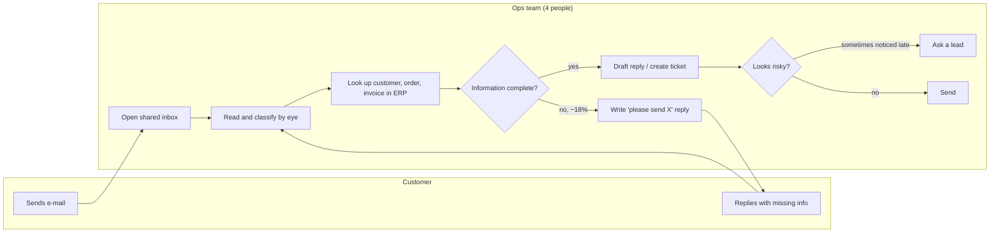
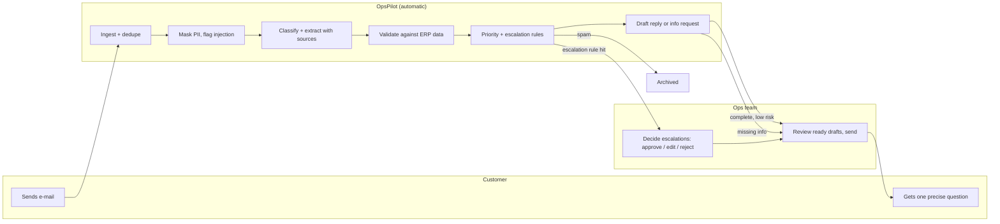

# Process map: shared operations inbox at Northwind Supply GmbH

Audience: Business / Operations Analysts. Figures marked *assumption* are planning inputs, not measurements.

## 1. As-is (manual)

Pain points: ~9 h average first response; 18% bounce-backs that restart the loop; urgent or legal messages found late because nothing ranks the queue.

## 2. To-be (OpsPilot)

Nothing is sent by the system. A person sends every reply.

## 3. RACI (R = does it, A = accountable, C = consulted, I = informed)

| Activity | Agent | Ops agent | Ops lead | Customer |
|---|---|---|---|---|
| Ingest, dedupe, mask PII | R | I | I | |
| Classify, extract, validate | R | I | A | |
| Priority and escalation flagging | R | I | A | |
| Draft reply / info request | R | C | A | |
| Review and send non-escalated draft | | R | A | I |
| Decide escalated case (approve/edit/reject) | | C | R, A | |
| Change rules, thresholds, prompts | C | C | R, A | |
| Handle rejected / failed runs | | R | A | |
| Provide missing information | | | | R |

## 4. KPI definitions

| KPI | Definition |
|---|---|
| Messages processed | Tasks created (duplicates excluded) |
| Auto-resolved % | Tasks archived as spam, or `ready_to_send` with **no** human review decision, / all tasks |
| Needing info % | Tasks `awaiting_customer` / all tasks |
| Escalated % | Tasks with at least one escalation reason / all tasks |
| Median processing time | Median of (run finished - run started) over completed, non-duplicate runs. Excludes time waiting for a human |
| Estimated hours saved | (messages x 6 min *assumption*) - (escalations x 4 min + non-escalated info requests x 2 min), in hours |
| LLM cost per message | Sum of audit-event cost / messages (EUR) |
| SLA breached | Open task (not closed / archived / rejected) whose `sla_due_at` has passed. `sla_due_at` = received time + first-response hours for its priority |
| SLA at risk | Open task due within 2 hours |
| Escalation recall (eval) | Escalations the system raised / escalations the ground truth requires. The KPI that matters most |
| Missing-info recall (eval) | Missing required fields detected / missing required fields in ground truth |

SLA policy (first response / resolution): P1 1 h / 8 h, P2 4 h / 24 h, P3 8 h / 72 h, P4 24 h / 120 h.

## 5. Routing and escalation rules

| Rule | Trigger |
|---|---|
| Amount | > EUR 5,000 (order value from product prices, otherwise stated amount) |
| Legal | threat of lawyers, legal action, damages, GDPR/DSGVO rights |
| Severity | complaint with high severity (e.g. production stopped) |
| VIP | any of the 5 VIP customers |
| Confidence | classification confidence < 0.7 |
| Injection | text that tries to instruct the system |
| Thread | 3 or more messages without resolution |

Team by category: orders to Sales Operations, invoice queries to Finance, refunds/complaints/general to Customer Service, supplier documents to Accounts Payable, access requests to IT Service Desk.
